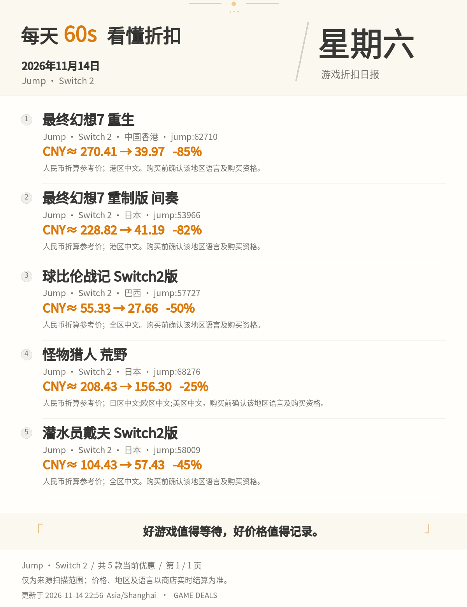

<div align="center">


# 游戏折扣订阅

_🎮 查游戏价格，订阅好折扣，每天一张日报。_

[](https://www.python.org/)
[](https://github.com/AstrBotDevs/AstrBot)
[](changelog.md)
[](LICENSE)
[](https://github.com/Cvandia/astrbot_plugin_game_deals/actions/workflows/tests.yml)

**简体中文** · [详细说明](docs/usage.md) · [更新日志](changelog.md)

</div>

---

## 📝 介绍

AstrBot 游戏折扣插件：支持 **Jump / 小黑盒同款比价、Steam 价格查询、群聊与私聊订阅、每日折扣图片或文字日报**。使用 APScheduler 定时检查，SQLite 持久保存，提供独立指令和 **7 个 LLM 工具**。

> 小黑盒当前覆盖 Switch 系列的有限目录，不含 PC 商城券后价；“今日折扣”表示当前来源扫描范围内的优惠。不同版本和地区分别标注，价格以商店结算为准。

## 💿 安装

在 AstrBot 的插件管理中使用仓库地址安装：

```text
https://github.com/Cvandia/astrbot_plugin_game_deals
```

手动安装时，将仓库放到 `data/plugins/astrbot_plugin_game_deals/`，在 **AstrBot 使用的 Python 环境**安装依赖后重载：

```bash
python -m pip install -r data/plugins/astrbot_plugin_game_deals/requirements.txt
```

支持主动文字及图片消息的适配器可使用定时推送。当前声明适配 OneBot（`aiocqhttp`）、Telegram；实际投递请在自己的实例验证，QQ 官方 API 不支持本插件采用的主动发送方式。

## 🚀 使用

| 功能 | 指令示例 |
| --- | --- |
| 综合比价 / 搜索 | `/游戏比价 马车8` · `/游戏搜索 jump 马力欧` |
| 单款价格 / 当前折扣 | `/游戏查价 jump:294` · `/今日折扣 steam 5` |
| 订阅 / 退订游戏 | `/订阅游戏 jump:294` · `/退订游戏 jump:294` |
| 查看订阅 / 检查时间 | `/游戏订阅列表` · `/折扣通知时间 20:30` |
| 图片日报 | `/订阅折扣日报 20:30 jump 5 image` |
| Steam / 小黑盒日报 | `/订阅折扣日报 20:30 steam 5 image` · `/订阅折扣日报 20:30 heybox 5 image` |
| 日报设置 / 退订 | `/折扣日报样式 图片 jump` · `/退订折扣日报 jump` |

来源：`jump`＝Switch 2，`switch`＝Jump Switch，`heybox`＝小黑盒 Switch 系列，`steam`＝Steam；日报管理还支持 `all`。完整指令见 `/游戏折扣` 或 [使用文档](docs/usage.md)。

群内修改通知时间、日报和发送样式需 **AstrBot 管理员**；私聊用户可自行管理。命令唤醒与 @ 要求遵循 AstrBot 配置。

启用 LLM 工具后可直接说：“马车8现在多少钱？”、“每天晚上八点半用图片推送5款 Switch 2 折扣”。需要模型支持工具调用，并在当前 Agent 开放本插件工具。

<details>
<summary>📸 图片日报效果</summary>



</details>

## ⚙️ 配置

在 AstrBot 插件配置页面设置，修改全局配置后重载插件：

| 配置项 | 默认值 | 说明 |
| --- | --- | --- |
| `timezone` / `default_time` | `Asia/Shanghai` / `09:00` | 默认北京时间与检查时间 |
| `default_source` | `jump` | 默认查询来源 |
| `digest_send_mode` | `text` | 日报全局样式：`text` 或 `image` |
| `digest_image_fallback` | `true` | 图片失败时回退文字 |
| `digest_image_rows` | `8` | 每张图片最多游戏数，自动分页 |

更多配置、权限、数据备份与投递边界见 [详细说明](docs/usage.md)。

## 💝 鸣谢

[AstrBot](https://github.com/AstrBotDevs/AstrBot) · [APScheduler](https://github.com/agronholm/apscheduler) · [Pillow](https://github.com/python-pillow/Pillow) · [heybox-url](https://github.com/huandu/heybox-url) · [Noto Sans SC](https://github.com/notofonts/noto-cjk)

README 排版参考 [uv-project-template](https://github.com/Cvandia/uv-project-template)。项目采用 [MIT](LICENSE)，第三方算法和字体保留各自的 [许可证](licenses/)。
